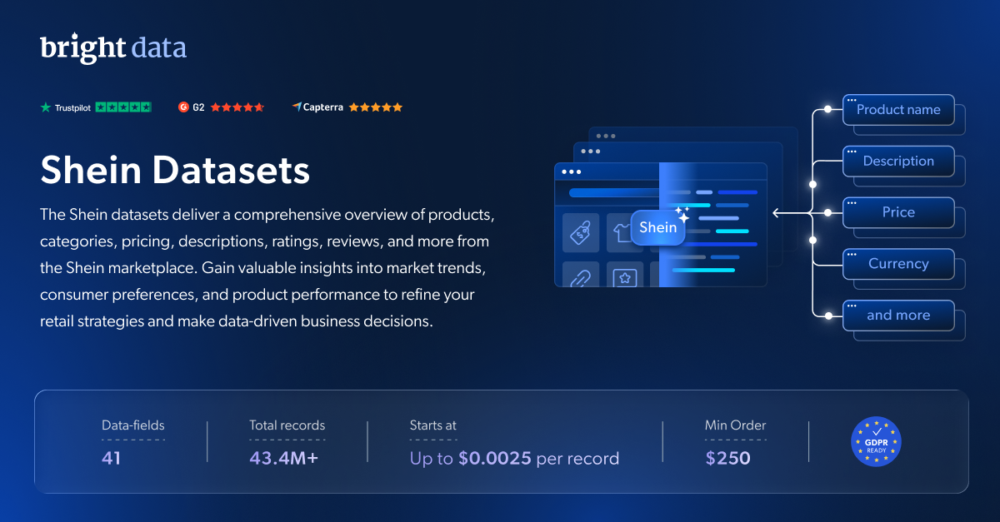

# Shein 数据集样本

<h2>包含 1001 款 Shein 商品的样本数据集</h2>

<a href="https://www.bright.cn/products/datasets/shein">
   
</a>

包含 1000 多款商品的 Shein 数据集样本。该数据集通过 <b>Bright Data API</b> 提取。

<h2>此免费数据集包含的数据点：</h2>

* ```product_name```：商品名称或标题
* ```description```：商品的文本描述
* ```initial_price```：商品的原价或起始价格
* ```final_price```：应用任何折扣或促销后的商品当前价格或最终价格
* ```currency```：标价所使用的货币
* ```in_stock```：表示商品当前是否有库存（True/False）
* ```color```：商品可选的颜色
* ```size```：商品可选的尺码
* ```reviews_count```：客户为商品提供的评论数或评分数
* ```main_image```：展示商品的主图
* ```category_url```：与商品类别关联的 URL 或链接
* ```url```：商品页面的 URL 或链接
* ```category_tree```：商品所属类别的层级树状结构
* ```country_code```：表示销售国家或原产国的国家/地区代码
* ```domain```：发布该商品的域名或网站
* ```image_count```：与商品关联的图片总数
* ```image_urls```：指向商品相关图片的 URL
* ```model_number```：与商品关联的型号（SKU）
* ```offers```：与商品相关的任何特价优惠或促销信息
* ```other_attributes```：商品的其他属性或特征
* ```product_id```：与商品关联的唯一标识符或代码
* ```rating```：客户为商品给出的平均评分
* ```related_products```：与当前商品相关的其他商品信息
* ```root_category```：商品所属的根类别或顶级类别
* ```top_reviews```：商品的热门或精选评论
* ```category```：商品所属的具体类别
* ```brand```：与商品关联的品牌或品牌名称
* ```all_available_sizes```：每款商品所有可选尺码的列表

以及更多内容。

这是“Shein 商品（公开数据）”数据集中的样本子集，该数据集包含超过 <b>32,800,000 款商品</b>。

可用的数据集文件格式：<b>JSON、NDJSON、JSON Lines、CSV 或 Parquet。文件还可选择压缩为 .gz 格式</b>。

数据集交付方式选项：<b>电子邮件、API 下载、Webhook、Amazon S3、Google Cloud Storage、Google Cloud PubSub、Microsoft Azure、Snowflake、SFTP</b>。

更新频率：<b>单次、每日、每周、每月、每季度或自定义频率</b>。

可在已提取数据点的基础上添加数据增强：<b>根据请求提供。</b>

<b>[获取完整的 Shein 数据集](https://www.bright.cn/products/datasets/shein)</b>。

<a href="https://www.bright.cn/products/datasets/shein">
   
</a>

<h2>Shein 数据集有哪些使用场景？</h2>

<h3>1. 品牌情感分析</h3>
深入分析商品评论和评分，了解消费者意见，并确保你的产品符合市场预期。使用 Shein 数据集了解客户对特定商品或整个品牌的看法，从而帮助你优化商业策略。

<h3>2. 消费者需求洞察</h3>
发现库存缺口、识别特定商品不断增长的需求，并洞察消费者趋势。Shein 数据集能帮助企业制定战略性库存管理决策、优化库存水平并简化供应链，从而提高效率。

<h3>3. 竞争性定价策略</h3>
通过识别竞争对手产品中相似的商品和类别，制定稳健的定价策略。利用 Shein 数据集确定最优价格、发现定价缺口，并根据实时市场数据实施动态定价模型。

<h2>学术研究人员和 NGO 可免费使用网页爬虫工具和数据集</h2>

Bright Initiative 为顶尖学术院系和研究人员，以及致力于推动各类环境与社会事业的 NGO 和 NPO，提供 Bright Data 的 <b>[网页爬虫工具 API](https://www.bright.cn/products/web-scraper)</b> 和 <b>[即用型数据集](https://www.bright.cn/products/datasets)</b>。你可以在<b>[此处](https://brightinitiative.com)</b>提交申请。
